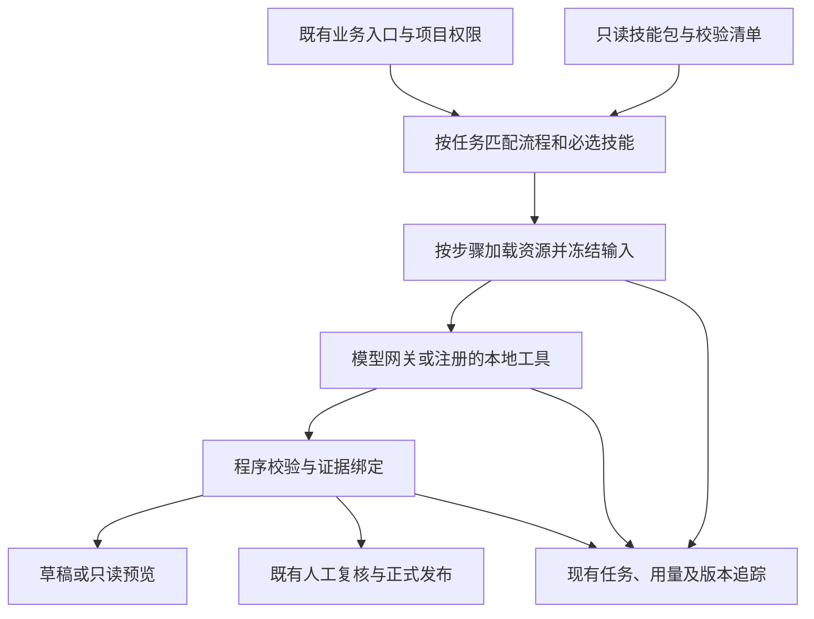

# PaperAssist-System 统一 Skills 技能系统总领方案

**当前状态** · 2026-11-25 · B00–B03 用户验收通过，生产规模 P95 和 R 镜像对外分发条件见 B03 收口记录 · `feat/runtime-skills` · 基线 `main@5de3df8`

## 1. 背景与决策

2026 年 11 月 24 日，启动了面向 PaperAssist 生产运行时的 Skills 调查。目标是让 SCI 写作、毕业论文和数据分析复用经过版本管理的科研规则，同时由平台管理模型外发、工具执行、项目权限、版本追溯和结果验收。开发时使用的 Codex skills 继续由开发环境管理。

首次审计在 `9508203` 及当时的工作区上进行。审计发现，项目已有可复用的 PostgreSQL 任务账本、RabbitMQ/Celery、模型回执、证据冻结、R/Python 执行器和 Word 交付。各领域的 Prompt 分散维护，缺少统一的技能注册、按任务组装与版本追溯。SCI、学校与科研计算各有既定合同，模型输出最终需要经过项目的权限、来源和结果检查。

2026 年 11 月 25 日，用户确认采用原推荐方向，要求先核对新合入 `main` 的改动，再开分支和编写本文。核对表明，两笔新提交完善了写作外发、图件拼版和 Bulk 交付，也带来了必须纳入回归的流式改稿及旧授权退役行为。原选型有效，接入点更新为最新主线的外发包、模型网关和固定成果服务。

**架构决定** · 采用路线 A，以开放 Agent Skills 约定组织内容，使用 PaperAssist 自己的轻量技能注册和确定性流程编排。首批用 **SCI 叙述性综述初稿** 和 **Bulk RNA-seq 已有结果的只读 QC/PCA 预览** 验证同一套运行时。前一条验证技能组合、证据和模型授权，后一条验证已注册工具、资源权限和产物血缘。本文评审通过后，按 B00–B03 开展，各批次由用户分别确认。

## 2. 最新主线基线

### 2.1 已核对的提交和影响

通过 `git ls-remote` 核对远端，本地 `main`、`origin/main` 与远端 `refs/heads/main` 同为 `5de3df8c219c4cd0db325b1a45a9c9dcedd9926b`。在干净的工作区从该提交创建 `feat/runtime-skills`。相对首次审计的 `9508203`，主线新增 `1273a84` 和 `5de3df8`，合计变更 173 个受版本控制的文件。

| 范围 | 最新主线行为 | Skills 接入约束 |
| --- | --- | --- |
| SCI 模板与毕业论文材料 | `1273a84` 完善 SCI 自定义章节标题、顺序和层级，以及毕业论文学校模板、章节资料、图件的切换。资料和模板保存带版本检查。 [SCI 入口](../../../frontend/src/features/customer/CustomerSciTemplate.tsx) · [项目 API](../../../backend/app/api/projects.py) · [论文结构](../../../backend/app/domain/manuscripts/paper_plan.py) | 流程以已采用的章节和模板版本为准。SCI 综述沿现有 `narrative_review` 分支组装，保留用户已确立的章节顺序和语言。 |
| 论文流式改稿与问答 | `1273a84` 在普通写作任务内增加章节范围的流式回复。预览冻结文字、范围、模型、必要图件与请求体。Worker 在现有模型网关下提交或按响应 ID 和进度游标恢复。前端读取业务回复进度，终态候选仍按写作合同验证。 [外发预览](../../../backend/app/domain/manuscript_writing/authorization.py) · [网关](../../../backend/app/domain/model_usage/gateway.py) · [执行与进度](../../../backend/app/domain/manuscript_writing/draft_chat.py) · [改稿页面](../../../frontend/src/features/customer/SciDraftRevision.tsx) | 首批范围为初稿生成。流式改稿、仅问答、历史非流式请求和图件外发继续走各自原合同，并列入回归。流式片段只用于反馈进度，正式结果仍以终态检查为准。 |
| SCI 与毕业论文图件拼版 | `1273a84` 接入项目内拼版、覆盖编辑和取消拼版。一次最多选 10 张原图。取消后按现有占用规则释放原图。 `5de3df8` 核验 `expected_revision` 和 `base_revision`，区分实际用作编辑基础的版本与当前头版本，保护成功结果免受过时配置覆盖。旧渲染器的未完成任务按退役状态处理，已完成图件仍可下载。 [拼版 API](../../../backend/app/api/sci_figures.py) · [版本检查](../../../backend/app/domain/research_results/figures.py) · [原图占用](../../../backend/app/domain/research_results/paper_figure_assembly.py) | 图件读取使用项目范围、固定来源、当前可访问状态和摘要。以后接入图件解释时继承图件权限和原图占用规则。 |
| 写作授权 | `5de3df8` 把旧金额型授权按已关闭处理。新写作按当前授权绑定与调用次数准入。已取得响应 ID 的历史调用仍可续取，写入候选前还要检查当前来源和父稿。 [授权状态](../../../backend/app/domain/manuscript_writing/authorization.py) · [历史回执恢复](../../../backend/app/domain/manuscript_writing/live_execution.py) | 新内容使用新外发快照和当前授权。旧金额授权不能产生新的模型提交。回滚同样遵守该限制。 |
| 分析员和 Bulk 报告 | `1273a84` 调整单细胞与 Bulk 步骤导航、矩阵核对、比较设置和固定结果。 `5de3df8` 计入工作表分片重复表头、附表索引及正文预留，按工作簿实际预算优先保留所选比较和必要表格。按整表取舍，交付件说明省略数量和完整来源下载路径。 [分析工作流](../../../frontend/src/features/bio-insights/BulkWorkflowWorkspace.tsx) · [附表预算](../../../backend/app/domain/bio_reader_reports/bulk.py) · [报告材料](../../../backend/app/domain/bio_reader_reports/service.py) | 首批只读预览以原分析的固定结果和产物索引为源。报告里的入选表不作为原结果的完整清单。试点复测完整下载、Word、XLSX 与报告限制提示。 |
| 数据库和本地启动 | 主线源码迁移头为 `0094_sci_revision_chat`，承接 `0093_paper_figure_cancel`。本地启动器在 API 进程启动前加载必要的生信运行时清单路径。Worker、Compose 发行配置和依赖清单在这两笔提交中保持一致。 [拼版迁移](../../../backend/alembic/versions/0093_paper_figure_cancel.py) · [改稿迁移](../../../backend/alembic/versions/0094_sci_revision_chat.py) · [开发启动器](../../../script/dev/dev.ps1) | 源码迁移头作为计划基线。实际部署库 revision 由各环境的预检读取和登记。Skills 首批优先复用现有任务、外发包和结果存储。 |

### 2.2 原审计结论中适用于当前基线的部分

- **业务和调度。** 角色工作台调用 FastAPI，API 执行项目范围和权限校验。异步任务写入 PostgreSQL 与 outbox，Dispatcher 经 RabbitMQ 投递，Celery Worker 按任务类型处理。恢复与最终成果由领域服务和任务账本管理。当前串行任务位会受远程轮询占用，扩量前须采集实际队首等待。 [API 入口](../../../backend/app/main.py) · [任务分派](../../../backend/app/domain/tasks/execution.py) · [串行队首](../../../backend/app/adapters/task_execution_store.py)
- **模型和 Prompt。** 统一网关记录回执、请求摘要、用量和恢复状态。普通文本有结构化输出合同并拒绝通用工具参数，绘图另有受控 Code Interpreter。写作、统计、解释、文献、读者报告和学校规则各有提示词。旧图表和解释恢复仍需照顾历史。新增流式写作进一步表明，外发包与调用网关是收口点。 [Responses 适配器](../../../backend/app/adapters/models/openai_responses.py) · [模型网关](../../../backend/app/domain/model_usage/gateway.py) · [分析推荐策略](../../../backend/app/domain/analysis_recommendation/policy.py)
- **论文与文献。** 三类稿件共用事实稿、外发预览、授权、候选和 Word，一般客户页面以初稿为主。有独立的科学复核、语言复核与正式发布合同，其角色可达性继续单独核查。PubMed 有队列、去重、摘要和命中来源。DOI resolver、表述与来源匹配、PMC 历史回读和正式核验的实际可用范围不同。新流程沿用已选文献及其阅读范围。 [写作接口](../../../backend/app/api/manuscript_writing.py) · [复核发布](../../../backend/app/domain/manuscript_writing/live_publish.py) · [文献执行](../../../backend/app/domain/literature/execution.py) · [已选摘要冻结](../../../backend/app/domain/manuscripts/selected_references.py)
- **科学能力。** Bulk、单细胞和空间均有业务执行链及各自限定的历史实测。Bulk 的独立 R 对照曾有部分超差，须沿用同引擎复算和跨引擎参考的不同口径。单细胞和空间的供体、批次和观测层级限制记录到解释中。代谢组接已制备定量矩阵，基因组相关以现成文件特征提取为当前边界。 [Bulk B08](../阶段04/2026-11-11-Bulk-B08-真实数据独立参考与兼容验收记录.md) · [单细胞历史](../阶段04/2026-11-05-单细胞七批实施记录.md) · [空间历史](../阶段03/2026-10-29-CR-B02-实施与验证记录.md) · [代谢矩阵历史](../阶段04/2026-11-01-客户需求完善第5批-子包一实施记录.md)
- **发行。** 仓库发行 Compose 默认关闭实时写作、NCBI 和绘图 Worker，Worker 位于内部网络。开发容器健康和本地运行时准入都不足以证明目标部署可做实时外发。当前发行源文件采用范围清单，必须把将来的 `SKILLS/` 显式加入打包、比对及回滚演练。 [发行 Compose](../../../compose.release.yml) · [发行源清单](../../../script/release/release.py) · [开发 Worker](../../../script/dev/worker_stack.py)

### 2.3 成文前验证

| 已验证 | 结论和限制 |
| --- | --- |
| 后端离线定向测试 | **176 项通过**。使用现有环境，禁用 pytest 缓存和全局 conftest，测试临时目录使用本项目忽略的运行目录。覆盖冻结请求、流式回执续取、范围内改稿与图件净化、写作数字合同、拼版渲染与历史版本、Bulk 工作簿预算。首次外部临时目录因 Windows 写权限失败，换目录后的整组复测通过。 [流式测试](../../../backend/tests/adapters/test_frozen_writing_stream.py) · [改稿图件](../../../backend/tests/domain/test_sci_revision_figures.py) · [拼版](../../../backend/tests/domain/test_research_figures.py) · [报告预算](../../../backend/tests/domain/test_research_reports.py) |
| 前端组件定向测试 | **5 个文件、74 项通过**。覆盖流式改稿、SCI/毕业论文拼版共用入口、论文版次导航、Bulk 工作流和生信报告。结果基于 Vitest/jsdom 与接口替身。 [改稿](../../../frontend/src/features/customer/SciDraftRevision.test.tsx) · [拼版](../../../frontend/src/features/customer/CustomerSciFigures.test.tsx) · [导航](../../../frontend/src/features/customer/CustomerPaperDraftNavigation.test.tsx) · [Bulk](../../../frontend/src/features/bio-insights/BulkWorkflow.test.tsx) · [报告](../../../frontend/src/features/bio-reader-reports/BioReaderReport.test.tsx) |
| 现有已知测试缺口 | 生信报告导出集成用例单独收集时仍因旧辅助函数 `authorize_user_and_project` 的导入失败。它不计入通过数，B00 按当前启用策略重接夹具并执行受影响用例。 [导出用例](../../../backend/tests/api/test_bio_reader_report_export.py) · [当前报告叙述夹具](../../../backend/tests/api/test_reader_report_narratives.py) |

本轮验证覆盖上述子集。PostgreSQL 迁移和读写集成、真实模型和文献 API、真实数据复算、Edge、Microsoft Word/WPS 原生开版、商用环境和科研结论均保留独立验收项。既有论文样本的实测证据可用于选取回归材料。 [论文历史验收](2026-11-17-SCI与毕业论文客户工作台-B01-B04用户验收记录.md) · [补验记录](2026-11-18-论文工作台待验证项补验.md)

## 3. 技术选型与引入边界

| 路线 | 取舍 | 决定 |
| --- | --- | --- |
| A．现有平台内编排 | 固定业务顺序可以复用现有项目权限、队列、外发、用量和发布。首批新增依赖少，能将每次模型提交和本地步骤对应到现有任务。平台需要自行维护注册、流程组合和验收。 | 作为主线。 |
| B．Deep Agents | 提供 Agent 循环、渐进发现、子 Agent 和工具后端。接入 PaperAssist 要处理双重任务状态、调用次数、日志和沙箱，以及 LangGraph 等依赖。多轮调用成本和可靠性要用本项目样本测量。 | 有固定流程无法覆盖的探索式任务时，在隔离数据集上单独评估。 [Skills 文档](https://docs.langchain.com/oss/python/deepagents/skills) · [包发布](https://github.com/langchain-ai/deepagents/releases/tag/deepagents%3D%3D0.7.41) · [MIT 许可](https://github.com/langchain-ai/deepagents/blob/main/LICENSE) |
| C．OpenAI 原生 Skills | Responses Hosted Shell 使用版本化技能引用或内联包。Local Shell 由调用方执行并回传。Agents API 可在沙箱能力目录发现技能。托管和自管均需评估账户能力、工具费用、外发、保留和恢复。当前网关会拒绝通用文本工具，接入须有新适配器。 | 先保留现有 Responses 调用。原生 Skills 如有业务收益，限单任务、公开或合成材料试验。 [OpenAI Skills](https://developers.openai.com/api/docs/guides/tools-skills) · [数据控制](https://developers.openai.com/api/docs/guides/your-data) · [资费](https://developers.openai.com/api/docs/pricing) |

`SKILL.md` 采用 Agent Skills 的 YAML frontmatter 与 Markdown。 `skills-ref` 可作规范和测试样例的参照，上游将其定位为演示。首批拟用现有 PyYAML 完成受限解析。任务调度、权限、生命周期和科研质量检查由平台代码提供。 [开放规范](https://agentskills.io/specification) · [集成指南](https://agentskills.io/client-implementation/adding-skills-support) · [skills-ref](https://raw.githubusercontent.com/agentskills/agentskills/main/skills-ref/README.md) · [PyYAML 许可](https://raw.githubusercontent.com/yaml/pyyaml/6.0.3/LICENSE)

| 科研候选 | 结论 |
| --- | --- |
| K-Dense Scientific Agent Skills | 首次调研核对到 `c21d13b`。仓库及所看写作、综述和引用技能声明 MIT，实际技能有各自依赖和元数据。借鉴证据约束与质检思路，检索和报告复用项目工具。 [维护提交](https://github.com/K-Dense-AI/scientific-agent-skills/commit/c21d13b3cc2894680229ba9959a53281acb9200e) · [写作示例](https://raw.githubusercontent.com/K-Dense-AI/scientific-agent-skills/c21d13b3cc2894680229ba9959a53281acb9200e/skills/scientific-writing/SKILL.md) |
| Kalaris Research Agent Skills | 核对到 `a74b0db`。MIT `abstract-and-title` 可在审定范围内作为可选纯文本参考，保留上游声明。引用核验依赖外部 API，PRISMA 是独立流程的参考。首批四个核心技能自研。 [声明](https://raw.githubusercontent.com/KalarisLabs/research-agent-skills/a74b0dbe5fa865d73b9f250ba5b0c9f107bd1baa/THIRD_PARTY_NOTICES.md) · [摘要与标题](https://raw.githubusercontent.com/KalarisLabs/research-agent-skills/a74b0dbe5fa865d73b9f250ba5b0c9f107bd1baa/skills/abstract-and-title/SKILL.md) · [PRISMA](https://www.prisma-statement.org/prisma-2020-statement) |
| Claude Scientific Writer | 核对到 `2.23.0`。主体 MIT，涉及 Claude Agent SDK、Parallel 检索、LaTeX 等，以及单独许可的 PyMuPDF。借鉴写作流程，整套运行工具留在候选评估。 [运行依赖](https://raw.githubusercontent.com/K-Dense-AI/claude-scientific-writer/9820740d252800ecf0b8fc066ffb5bf9659f4a51/pyproject.toml) · [PyMuPDF 许可](https://pymupdf.readthedocs.io/en/latest/about.html#license-and-copyright) |

引入第三方内容前按实际文件、固定版本与用途登记来源、许可、版权声明、软件包、API、数据库和素材权利。优先使用 MIT、Apache-2.0、BSD 等宽松许可。未知许可暂停引入，禁止商用的内容排除，Copyleft 按服务端使用或镜像分发另审。PubMed 摘要、PMC 正文、图件、数据和模板分别判断能否获取、缓存、外发和交付。DOI 可匹配也要核对书目是否相符，摘要只说明其可支持的范围。 [现有第三方清单](../../../third_party/README.md) · [NCBI 政策](https://www.ncbi.nlm.nih.gov/home/about/policies/) · [PMC OA](https://pmc.ncbi.nlm.nih.gov/tools/openftlist/) · [Crossref 元数据许可](https://www.crossref.org/documentation/retrieve-metadata/#licensing)

## 4. 目标架构与职责



| 层 | 职责 | 接入点 |
| --- | --- | --- |
| 业务流程 | 校验用户意图、权限、项目类型、材料、版本和前置状态。决定执行顺序、确认动作与交付终点。 | 现有写作预览、任务服务、分析结果入口与发布服务。 |
| Skills | 声明场景、可执行前提、领域规则、证据和质量要求。共享证据边界及表达规范。 | 独立 `SKILLS/`，任务执行时加载经批准的正文与资源。 |
| 执行工具 | 用类型化参数执行实际检索、文本生成、计算、作图和渲染。核验原件、来源和输出。 | 现有 PubMed、Responses 网关、计算执行器、图件适配器与 Word 服务。 |

目录建议如下。星号标记 B01 范围，其余按后续批次的实际需求加入。

```text
SKILLS/
  scientific-writing/          *
    SKILL.md
    references/
  narrative-review/            *
    SKILL.md
  citation-verification/       *
    SKILL.md
  bulk-result-reading/         *
    SKILL.md
  literature-search/
  research-article-writing/
  thesis-writing/
  statistical-interpretation/
  figure-interpretation/
  single-cell-result-reading/
  spatial-result-reading/
  document-quality/
```

一级目录名与 `name` 一致，`description` 用于发现，`metadata.category`、`metadata.version` 用字符串。需授权的静态材料放 `assets/`，参考规则放 `references/`。产品配置指定唯一运行时根，加载范围与 `.agents/skills/`、Codex 用户 skills 等开发路径隔离。工具权限和技能依赖以版本化的后端流程映射为准。首期用只读发布包、进程内目录和功能开关即可。

### 4.1 业务与技能映射

| 场景 | 必选 | 条件加载和工具 |
| --- | --- | --- |
| SCI 叙述性综述 | `scientific-writing`、`narrative-review`、`citation-verification` | 使用现有 PubMed 与已选摘要。首批从已有证据开始。检索、目标期刊摘要规则由相应业务动作或明确配置触发。 |
| SCI 研究论文 | 科研写作、研究论文、事实和引文核验 | 提供固定计算结果、已核验方法、用户陈述和文献。图表、统计结果出现时加载对应解释规则。 |
| 毕业论文 | 科研写作、学校与章节规则 | 文献章和结果章按需要加载引文或统计规则。身份、声明、学校 Word 资料留在本地，走现有模板合同。 |
| Bulk RNA-seq | 对应结果读解，先接固定 QC/PCA | 由受限 Python 适配器验证来源，生成同源预览。后续解读对照范围和实验设计时再加载统计解释。 |
| 单细胞、空间及其他定量数据 | 相应领域边界和读解规范 | 以现有矩阵和固定结果为输入，用已注册的 Python/R 执行器。组织、供体、批次、观察层级与下游允许操作由业务校验。 |

## 5. 运行合同

1. **发布发现。** 构建与启动分别确认技能清单。解析时限制字节、目录深度和文件类别，拒绝坏 YAML、重复键、重复名称、非法版本、同版本不同内容、符号链接和资源越界。打包时记录正文和资源 SHA-256。发布包按统一字节规则生成，API 与 Worker 校验同一清单。无效技能无法注册，被启用流程依赖时阻断该流程并报告原因。
2. **确定性路由。** 以已鉴权的项目类型、操作、稿件分支、来源类别、语言和角色选择当前启用的流程。必选技能先解析依赖，再按固定顺序去重。可选技能由明确的业务条件启用。冲突、依赖环和缺失工具在发布检查或流程准入时报告。任务步骤有数量和耗时上限，首批无需让模型挑选技能。
3. **阶段加载。** 目录保留名称、描述、版本和类别。需要某个阶段时才加载被授权的内容与直接资源。权限规则和输出合同优先由平台校验。最终外发包只展开展示过的必要内容，材料过长时缩小范围或报告缺料，数值、引文及科学关系保留完整口径。
4. **冻结和签入任务。** 记录流程版本、技能 ID/版本/摘要、资源和适配器版本、供模型或工具使用的参数、来源版本、模型策略及实际外发摘要。将这些信息写入当前任务的受控扩展点或新版本合同。现有严格按字段和摘要校验的快照继续由原解析器读取。新写作授权绑定实际发送的精确请求体，范围或字节变化须重新预览确认。任务恢复以冻结版本为准，当前的权限撤销和外发停用继续生效。
5. **工具准入。** 适配器契约包括操作 ID、版本、输入输出 schema、项目范围、所需角色、是否写入、外发范围、时间与资源上限。输入是受约束的资源版本 ID 和参数。执行前通过领域服务核对项目、当前分配、资源状态与源摘要。后端只调用已注册的工具。 `allowed-tools`、上传文本、摘要、用户表格和模型建议无法提升权限。科学计算沿用现有隔离执行器和成果校验。
6. **执行与恢复。** 使用现有任务 ID、revision、租约、幂等键和模型回执。一次步骤恢复沿用原输入与摘要。已知响应 ID 时续取，提交不明时对账，明确未提交且满足准入时才准许新的提交。只读工具按可重试类别限次退避，超时、资源超限、撤销、来源变更、取消分别登记安全状态。部分结果先作为进度或候选，由原发布事务决定是否产生正式成果。
7. **结果与追踪。** 检查 schema、数字、单位、分组和方向、引用位置、图件来源、缺料与限制。区分书目匹配、摘录已核对、科学论断经人工确认、模型推断、待确认。Word 交付区分初稿和正式采用版本。记录任务、版本、耗时、用量、回执和检核结果，普通日志只记录必要的引用与错误分类。审计可回查当时所用版本，资料依法或按约删除后按现有生命周期处理原件和回放权限。

### 5.1 首批两条可验收链路

- **SCI 综述初稿。** 从当前客户 SCI 入口的 `narrative_review` 分支进入。已选文献及作者计划成为事实稿，按主题加载综述、科学写作和引用核验，生成冻结的外发预览。沿现有授权和 `manuscript_writing` 入队，B01 采用模型替身，B02 以公开且授权的资料作对照。写成候选后用现有初稿阅读和 Word 路径验证。引用范围、写作输出语言和章节选择按现有合同。当前用户发起检索时仍走原入口。 [准备与冻结](../../../frontend/src/features/manuscripts/preparePaperDraft.ts) · [提交](../../../frontend/src/features/manuscripts/submitPaperDraft.ts) · [模型执行](../../../backend/app/domain/manuscript_writing/live_execution.py) · [初稿 Word](../../../backend/app/api/sci_draft_reader.py)
- **Bulk QC/PCA。** 从现有分析员固定结果入口取得有权读取且带摘要的结果成员，调用 `bulk_plot_data` 相关 Python 逻辑生成受限预览。对照同一来源和配置的基准结果，核验样本轴、图值、比较标识及来源 SHA。业务终点是分析员预览。无模型调用和数据分析重新计算，审计记录可写，报告和客户发布仍经既有业务动作。 [固定结果](../../../backend/app/domain/bio_insights/results.py) · [图表适配器](../../../backend/app/adapters/bio_insights_engine/bulk_figures.py) · [分析员发布](../../../backend/app/domain/analyst_workspace.py)

## 6. 现有代码处置与接口迁移

| 决定 | 计划与影响 |
| --- | --- |
| 保留 | 权限、任务账本、模型回执、稳定响应 ID、调用次数准入、科学计算执行、固定文件、文献版本和现有 Word/原始下载。复用正式复核、发布、拼版版本和原图占用合同。 |
| 修改 | 首批在后端写作预览和 Bulk 预览两处接入技能流程，加入冻结版本和执行追踪。开发与发行构建显式纳入 `SKILLS/` 及哈希。面向客户的原公开请求结构继续可用。内部新合同按版本增加，旧快照按既定字段集校验。 |
| 合并 | 将新写作版本共用的证据边界、提示词组装和引用要求收拢。后续按真实入口合并重复的文献调用和共用渲染。学校、研究论文及综述仍有各自权限、数据和输出约束。 |
| 替换 | 对经过对照的新增流程逐条迁移 Prompt。正式稿引用逐步使用带出处和阅读范围的证据投影。已有候选、旧授权、历史输出和快照按当前兼容合同处理。 |
| 重构 | 让业务域管理流程，Worker 负责分派和恢复，模型网关负责提交、回执和限额。先量化队首等待，再决定是否单独调整调度。生信能力目录逐步提供配置可用性、在线状态和测试口径。 |
| 删除候选 | 未见实际入口的旧写作工作台组件、已排空的旧模型恢复路径，归 B03 或后续独立变更。删除前核对生产入口、角色、深链接、未完成任务、历史保留及固定成果。 |

## 7. 批次、依赖和验收终点

**批次依赖** · B00 → B01 → B02 → B03。B02 的商用外发准备可与 B01 离线验证并行，真实提交须在 B02 得到授权。每批记录提交基线、变更、用例、验证环境、剩余缺口和回退点。后续批次以用户确认当批结果和下一批范围为准。

### B00 · P0 固定基线与回归材料

- 固定开始实施时的 Git 基线，确认是与本文一致的主线或记录之后的差异。登记现用开发和试点环境，逐项标记代码、数据库 schema、Worker 镜像与渲染器版本。
- 核对 SCI 综述正常入口和已有公开材料中的证据范围。用一份固定 Bulk 结果记录项目、任务、样本轴、源成员、配置、SHA、预期 QC/PCA 值及原有下载。
- 恢复生信报告导出测试的当前授权夹具。加入受影响范围的定向回归，覆盖已合并的流式恢复、拼版基准版本、旧金额授权停止新提交和 Bulk 整表预算。优先使用现有测试与历史样本。
- 确认进入 B02 前要具备的测试账户、外发材料权利、费用上限和部署出口策略。隔离实测数据库需要时，按已确认的测试操作范围进行。
- **验收终点** · 受影响入口、固定下载与回归可重复。已知失败、跳过项、历史数据限制和待做的真实验证都有对应记录。B01 的两份对照样本和可运行检查明确。

**实施记录** · 基线已核对，SCI 与 Bulk 回归材料已固定，导出测试的旧授权夹具已修复，用户已验收通过。 [B00 实施与验证记录](2026-11-25-PaperAssist-Skills-B00实施与验证记录.md)

### B01 · P0 统一运行时与离线双试点

- 实现限定目录发现、格式验证、发布清单、流程选择、按步骤加载、执行版本追踪及启停开关。新增两条明确的业务映射，复用现有调用与存储点。
- 编写四个首批技能。将 SCI 综述 Prompt 组合绑定新版本和将要外发的精确材料，旧合同可继续读取。将 Bulk 只读预览接到现有固定结果验证与图表工具。
- 冻结的技能包随 API/Worker 发布。对 Windows 开发目录以及 Linux 容器执行相同目录和包哈希校验，覆盖找不到包、包不一致和资源越界。
- 用模型替身和已有固定图件验证阶段结果，使用混合任务重放验证原有 SCI、毕业论文流式改稿与初稿 Word、Bulk 原分析及报告行为。
- **验收终点** · 从正常业务入口完成两条离线链路。每次执行可回查实际使用的技能版本与来源。权限、历史、错误和恢复用例通过。流程关闭后旧业务可用。

**实施记录** · 四个技能、放行流程和两个业务接入点已完成离线定向验证。完整开发 Worker 构建和跨镜像离线校验已补验通过。真实调用、角色验收、性能和灰度回退进入 B02。 [B01 实施与验证记录](2026-11-25-PaperAssist-Skills-B01实施与验证记录.md)

### B02 · P1 真实验证与小范围灰度

- 按确认范围准备公开可用文献、合成材料及固定科研成果，建立同模型、同材料、同目标的有无 Skills 对照。来源库及模型账户使用测试和灰度环境，记录真实工具、版本、回执、费用与数据保留约定。
- 先过自动事实校验，再由独立评审核对科研质量。用真实客户、分析员角色在批准的测试项目中走查。抽查代表性 Word/WPS 文件、下载、恢复与数据权限。
- 灰度按流程和项目范围开启。监测失效输入、未知提交、超时、费用和队首等待。演练停止新任务、从原回执恢复与撤回到原流程。
- **验收终点** · 通过下述硬门槛和经 B00 校准的性能门槛。回滚过程保存旧任务和下载。扩大流量、正式部署与专业科学审查各自独立确认。

**实施与验收** · 2026 年 11 月 25 日，用户确认 B02 验收通过。20 个锁定字体和发行预检通过。隔离环境完成 SCI 真实 A/B、Bulk 原件回读、角色权限验证和配对镜像回退。同批补验完成 Edge 四账号角色走查、两份 SCI Word 的区域数修订、WPS 字体复验和 OpenAI 项目与用量对账。OpenAI 共两次新提交，合计估算 US$0.047950，外发已关闭。平台逐笔实收金额、扩大灰度和 P95 按 B02 记录保留待验证。 [确认清单](2026-11-25-PaperAssist-Skills-B02真实验证与灰度确认清单.md) · [实施与验证记录](2026-11-25-PaperAssist-Skills-B02实施与验证记录.md)

### B03 · P2 扩展与收口

- 用户确认启动 B03 后，依次扩到 SCI 研究论文、毕业论文、统计解释和一个固定的单细胞 R 专题。研究稿重点校验 Methods/Results/Discussion 与实际证据。毕业论文重点核对学校模板、身份、章节来源与历史回读。R 专题单独核对可执行环境、许可、资源、数值协议和科学解释。
- 逐入口迁移共享 Prompt 与校验，逐项确认查看、复核和发布的真实角色可达性。区分新能力、保留历史和删除候选。拆队列、系统综述、多库检索及通用探索 Agent 根据量化收益另定范围。
- **验收终点** · 每条新增流程有对应角色、固定材料、真实证据或明确待验项。旧数据、导出和服务兼容通过。光有组件、登记或适配器的能力仍按其可达状态登记。

**实施与验证** · 2026 年 11 月 25 日，用户批准启动 B03。SCI 研究首稿、毕业论文首稿、固定图件统计解释、单细胞 Propeller 组成只读四条流程已接入。首次补验完成本机灰度、Edge 角色、停启回退、代表性 Word/WPS 和公开单细胞的独立复算、项目发布及 Edge 只读。收口阶段修复毕业论文外发 schema、统计解释冻结指令和统计任务页结果读取，复用 SCI 与已固定的单细胞成果。两轮共五次真实 OpenAI 提交，三条模型流程有成功回执，按官方用量与计费明细归属本批 US$0.0856725。Microsoft Word 原生刷新、字体和本机负载已记录。生产规模 P95 需在目标环境实测。R 原镜像暂缓对外分发。 [B03 实施与验证记录](2026-11-25-PaperAssist-Skills-B03实施与验证记录.md) · [首次补验记录](2026-11-25-PaperAssist-Skills-B03待验证项补验记录.md) · [B03 收口记录](2026-11-25-PaperAssist-Skills-B03收口与验收记录.md)

**用户验收** · 2026 年 11 月 25 日，用户确认 B03 验收通过。 [B03 验收记录](2026-11-25-PaperAssist-Skills-B03收口与验收记录.md#8-用户验收)

## 8. 验收矩阵与量化门槛

| 验收项 | 用例与通过条件 |
| --- | --- |
| 发现、注册与更新 | 正常目录、缺必填、坏 YAML、重复字段、重名、目录穿越或链接、循环依赖、必要资源缺失、内容变更未升版分别测试。启用流程的清单完全可验证。API 与 Worker 摘要一致。升级后新任务读新包，旧任务继续按原版本完成或安全暂停。 |
| 路由与组合 | SCI 综述、SCI 研究、毕业论文及各种分析入口分别测试。角色、来源为空、已有固定材料、许可受限、关闭流程分别验证。必选无遗漏，依赖顺序稳定，同一步骤无重复。 |
| Python/R 及产物 | 在相同输入/运行版本下比对样本、单位、数值、轴、SHA 及图件来源。Bulk 首批新模型提交数为 0。将来 R 采用同引擎复算和独立参考双轨，阈值在检查结果前登记。原完整结果、Word 和复现包按现有规则可获取。 |
| 错误与恢复 | 覆盖无效技能、工具超时或缺失、模型 429/5xx、提交前断开、已取得 ID 后断开、响应校验、Worker 重启、任务重复投递、取消。按既有回执续取。重复模型提交、重复发布和无授权外发均为 0。 |
| 用户和资料隔离 | 两个客户、两个项目、分析员分配与撤回、管理员分别检查普通读、任务恢复、外发、临时目录、图件和下载。输入文本不能触发额外网络/文件读写。跨项目或未授权读取均为 0。 |
| 论文与证据质量 | 首轮建议至少 30 个写作案例，覆盖真实与虚假 DOI、书目误配、摘要范围、引用位置、技术语言和材料缺失。虚构引用、关键数字错误、无证据却标为已确认的关键论断均为 0。盲审记录结构、来源覆盖、科学边界及中英文质量。 |
| 分析读解质量 | 首轮建议至少 20 个固定结果案例，覆盖正常 QC/PCA、缺样本、错轴、配对和方向、旧版本、阈值外、不同数据处理口径与观察性结果。关键数值、单位、对照方向和样本范围与冻结事实一致。将科学结论审查单独登记。 |
| 成本与性能 | 对照记录输入、缓存、输出和推理 Token、模型提交次数、费用、队列等待和执行耗时 P50/P95、成功率。初步建议每份综述初稿至多一次新模型提交，P95 费用和执行耗时分别较基线增加不超过 10%。阈值在 B00 对照基线稳定后确认，真实账单、估算和未知分列。 |
| 历史和实际入口 | 对照普通和流式写作、图件拼版、Bulk 报告、单细胞/空间历史版本、权限、失败重试、固定结果和旧 Word。用实际角色完成浏览器路径，代表性 DOCX 分别验收 Microsoft Word 和 WPS。根据批次运行受影响的测试及关键失败路径。 |

本项目验收证据分为本地工程测试、隔离服务集成、真实模型/数据、专业审查、用户验收和部署。开放前按实际环境分别出具结果。真实数据、新模板、新期刊或新科研用途按实际覆盖记录。

## 9. 风险与回滚

| 风险 | 监测与处置 |
| --- | --- |
| 证据或稿件结构退化 | 出现虚构引文、关键数据错误或现有模板/章顺序回归时，关闭该流程的新技能路径，保留候选、版本和审计，用固定样本复核。 |
| 不可恢复的提交、队列拥堵或额度异常 | 按提交已知性分类，对已有响应继续使用原 ID。记录队首年龄、恢复次数和排队时延。超过灰度条件时先停试点新增流量，再诊断负载与花费。 |
| 发版时包或 schema 分叉 | API/Worker 对同一清单和任务格式做就绪检查；保留上一可用镜像和活动任务引用的技能包。有不兼容时先暂停新任务或排空，按确认的兼容组合恢复。 |
| 权限及资料许可变化 | 撤回分析员分配、用户外发同意或文章可用许可时，暂停后续步骤和导出。接入前验证日志、缓存、第三方保存和数据删除口径。 |
| 历史回读受损 | 使用主线固定样本核对旧金额授权、已取得响应 ID 的任务、已完成图件和 Word/原始分析下载。任何退役都以历史需求已得到满足为前提。 |

**回滚顺序**

1. 暂停相关流程接收新的 Skills 任务，记录开关、版本、任务、模型账本和影响范围。
2. 新任务经评估可切回 B00 固定的原路径，用户已经确认的外发摘要若发生变化，按现合同重新确认。
3. 旧任务按所处阶段处理。未开始的新外发可撤销或暂停。已知响应 ID 按原回执续取，对未知提交只对账。已完成候选和产物可以回读，依旧按原权限和版本处理。
4. 需要切镜像时，配对验证上一版本 API、Worker、发布包和当前数据库 schema。需要保持新旧版本兼容时使用前向修复。历史存储、内容、运行时资料与备份由原生命周期维护。
5. 复验一条旧 SCI 写作、一条原分析和固定下载、权限、任务恢复及费用，再决定是否重新开启。回滚结果和仍待检查的任务在批次记录中登记。

## 10. 当前交接

B00–B03 均已获用户验收。当前交接为 `feat/runtime-skills` 的一次提交和推送，待用户确认提交说明与文件范围。验收登记时工作区未暂存、未提交、未推送。生产规模 P95 待目标环境实测，R 原镜像对外分发暂缓。 [B02 实施与验证记录](2026-11-25-PaperAssist-Skills-B02实施与验证记录.md) · [B03 实施与验证记录](2026-11-25-PaperAssist-Skills-B03实施与验证记录.md) · [B03 验收记录](2026-11-25-PaperAssist-Skills-B03收口与验收记录.md#8-用户验收)
