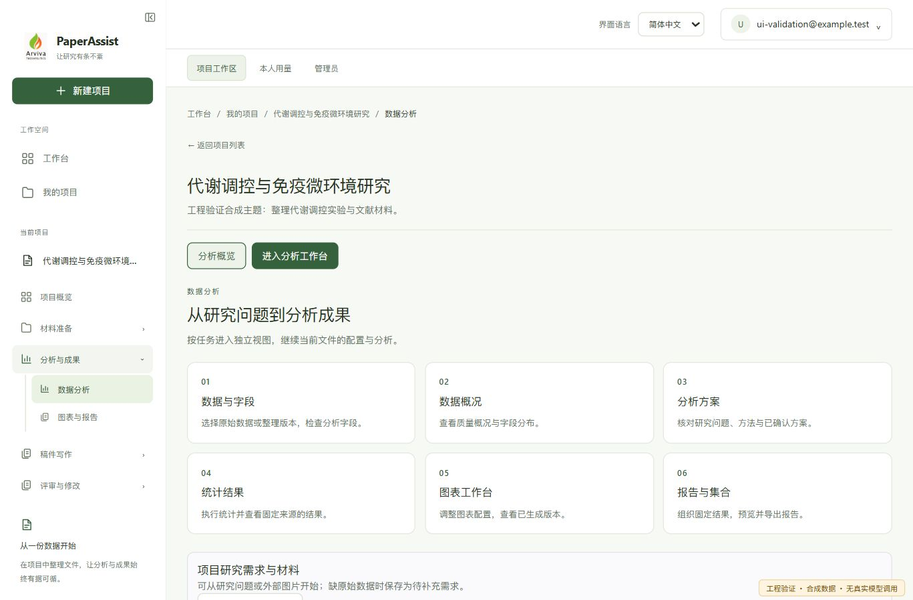
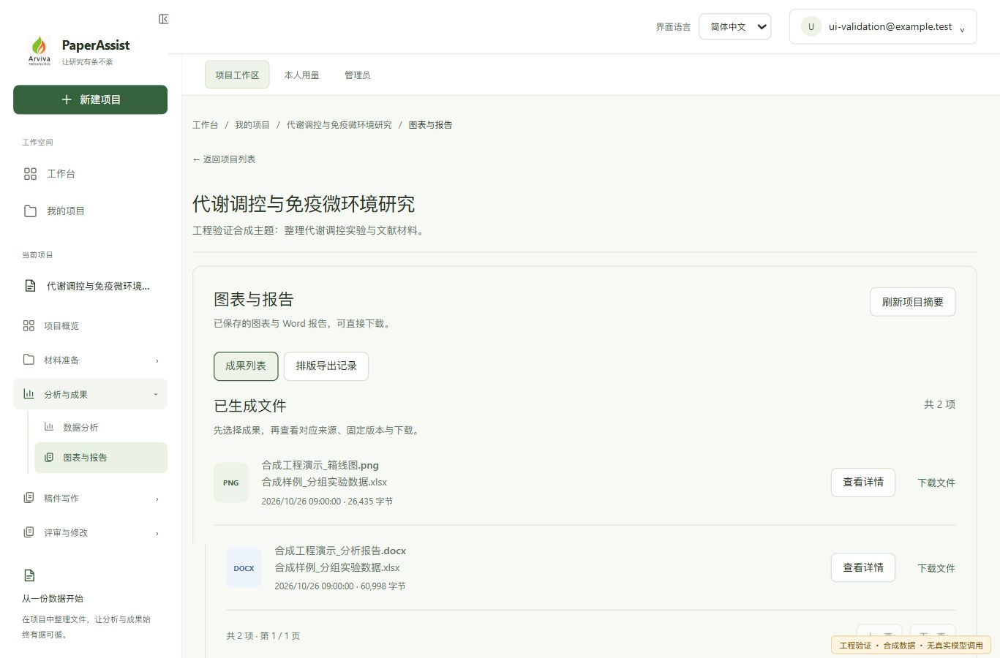
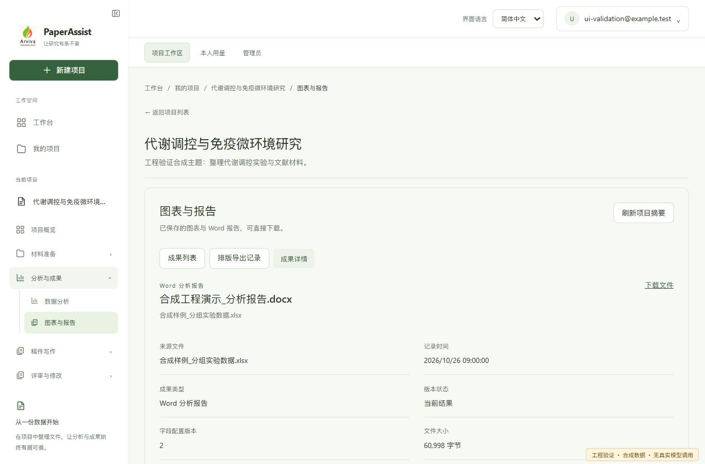

# 正式前端第3批交付记录

本批完成数据分析、图表与报告成果的视图分层。沿用正式组件、API、权限与任务逻辑；没有修改后端、替换分析引擎或迁移静态预览业务。第4—6批未在本轮实施。

## 入口与功能迁移

| 区域 | 现在的入口 | 保留的能力 |
| --- | --- | --- |
| 分析概览 | 六个任务入口 → 独立工作区 | 原始数据直接分析、材料先行研究需求 |
| 数据分析 | 字段配置 / 数据概况 / 分析方案 / 统计结果 | 原始与整理版本、工作表、字段检查、计划确认、统计方法、任务恢复 |
| 分析方案 | 编写 / 建议 / 历史 / 审核所选方案 | 原研究声明、方法与语言、建议授权、发布、待补材料 |
| 项目需求 | 创建需求 / 需求材料 / 历史与详情 | 材料声明与固定来源、历史任务、需求版本 |
| 图表与解释 | 当前结果成果 / 图表工作台与集合 | 原单图链与独立图表配置、版本、外发确认、解释均可达 |
| 多图工作台 | 列表 → 固定版本详情 → 编辑 / 解释 / 导出 | 按运行、来源、配置版本和语言绑定；历史版本不跳最新 |
| 报告集合 | 列表 → 固定集合版本 → 内容 / 预览 / 导出 | 固定图号和依赖、自动本地 Word、DOCX、PDF、排版入口 |
| 项目成果 | 成果列表 → 成果详情；另设排版导出记录 | 原受保护下载链接、来源/版本信息、排版任务链接 |

统计页默认折叠研究需求依据，关键来源与警告仍直接显示，优先展示结果。长表格、研究表单与报告正文仍允许必要滚动。

## 导航与状态

- 主要分析视图与文件写入 hash；成果详情包含 `kind + artifact + page`。保留原深链，拒绝重复、非法与不匹配参数。
- 同项目的视图、文件与已访问历史运行采用保活方式；不同对象分别保留草稿。浏览器跨成果页面前进后退不会清空后台分析文件选择。
- 切数据来源、替换配置、离开项目和刷新前检查相关草稿。强制刷新、关闭页面后不承诺恢复未保存内存草稿。
- 实际请求执行中阻止破坏性卸载；保留重试身份的未知请求仍按原流程处理，可明确确认放弃本地状态，不会因幂等键存在永久锁住项目。
- 计划发布异步完成时提示显式载入，不后台销毁成果草稿；只读结果刷新不替换已打开的运行。
- 失权仍清除工作区，迟到响应不能恢复旧内容。没有修改服务端来源、版本、语言、权限或付费授权规则。

## 工程验证

测试按模块与受影响集成路径执行，未运行后端全量回归。去除重复复测后覆盖 **76 个测试文件、686 个当前用例**。

| 执行组 | 已观察结果 | 证据 |
| --- | --- | --- |
| analysis / analysisPlan / datasetProfile | 42 文件、245 项通过 | `script/.runtime/ui-batch3-20261026/analysis-tests.log`、`analysis-tests.json` |
| 分析末轮调整 | 8 文件、84 项通过；最后 DatasetAnalysisSetup 33 项通过（替代前一轮31项） | `analysis-final-tests.log`、`analysis-empty-state-tests.log` |
| figures / explanations / reports / figure-workbench / report-collections | 20 文件、248 项通过 | `outputs-report.md`，执行终端记录 |
| 项目路由、成果、材料草稿与集成 | 14 文件、190 项通过 | `integration-final.txt` |
| 最后跨页面历史回归 | 3 文件、63 项通过；analysisNavigation 从19项增加到20项 | `navigation-final.txt` |
| 类型检查及正式生产构建 | 通过；输出到独立本地展示目录 | `build-final.txt` |
| 全前端 lint | 退出0；仅 StructureVersions.tsx 原有3条 Hooks 警告，无新增警告 | `lint-final.txt` |

构建在 `frontend` 目录执行与 `npm run build` 相同的两步，显式指定独立输出目录，避免改写旧验证服务正在读取的构建文件：

```powershell
npx.cmd tsc -b
node ./node_modules/vite/bin/vite.js build --outDir ../script/.runtime/ui-batch3-20261026/dist
```

Vite 保留已有的主包大于500 kB提示（本批最终约2.04 MB，gzip约571 kB）；本批没有进行包拆分。独立输出位于项目根之外，Vite提示不自动清空该目录，这是本地快照策略。

独立审查发现并修复：同图编辑覆盖草稿、未知请求永久锁定、历史运行/字段修订卸载成果草稿、非配置页读取错误无恢复、集合当前版本属于其他来源/语言时空白，以及旧图忙碌回调更新循环。末轮导航补丁也经复核，无未解决P1/P2。记录：`script/.runtime/ui-batch3-20261026/review.md`。

## 实际浏览器检查与效果

可交互地址：[第3批分析概览](http://127.0.0.1:4182/#project=ui-metabolism&section=analysis)。这是**正式前端生产构建配合本地合成响应**，页面明确标注“工程验证 · 合成数据 · 无真实模型调用”。不代理真实后端；业务写请求返回明确的422，不制造生成成功。

已实操：分析概览、字段选择、字段草稿→概况→返回保留、方案内部历史视图、统计与来源依据折叠、旧图与独立工作台切换、成果列表与固定详情、浏览器前进后退、手机导航抽屉开启和选择后关闭。合成概况端点的初始路径缺口已修复在展示服务中，没有改生产API。

最终浏览器实际加载 `index-Bl25pxRp.js`，页面控制台未观察到错误；细项见 `script/.runtime/ui-batch3-20261026/browser-checks.json`。

已检查约1367×900桌面和390×844窄屏；320、768、1024、1367像素的概览布局均无页面横向溢出。表格仍可在自身容器横向滚动。








## 边界与限制

- 本轮结果是工程验证和合成页面检查，不是用户验收、真实科研数据核验、真实模型/付费调用或真实 Word/PDF 排版验收。
- 展示服务内独立图表配置与报告集合为空列表；复杂固定版本、外发确认、未知提交与集合导出通过组件/集成测试验证。未将空列表展示说成真实生成完成。
- 原生确认框的自动化断言已覆盖；本轮没有把真实原生确认框、屏幕阅读器或200%浏览器缩放算作人工验收。
- 未提交、推送、合并或部署；保留本轮开始前工作区改动、数据、模板、历史成果及旧预览服务。
- 快照、合成服务、测试日志位于 `script/.runtime/ui-batch3-20261026/`；它们是本地运行材料。当前源代码清单位于 `changed-files.json`，对比基线为该目录的 `src-before`，不是Git HEAD。
