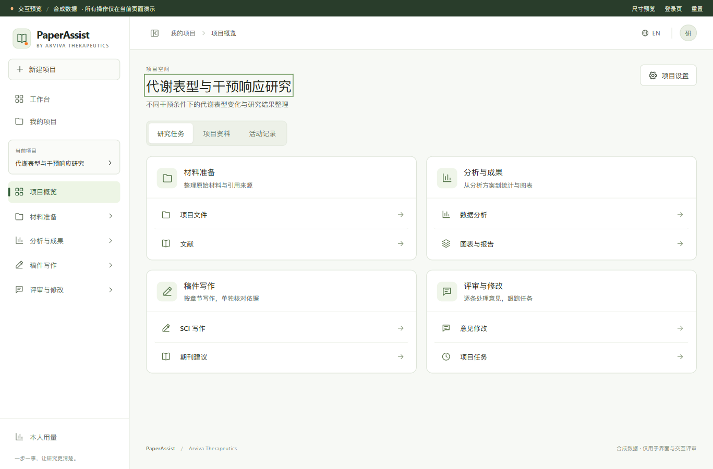
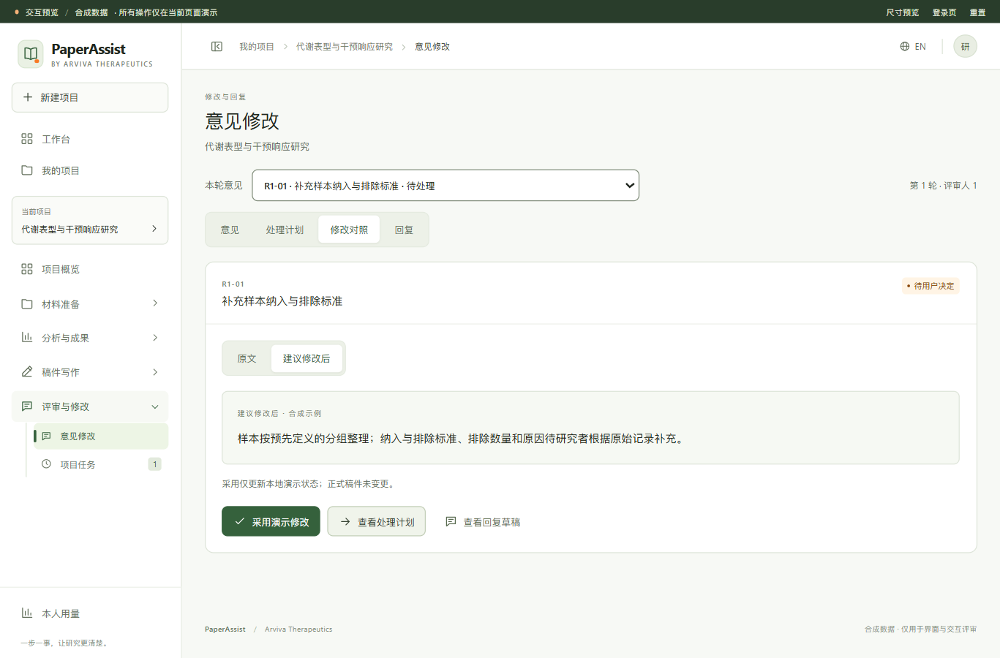

# Arviva / PaperAssist 交互预览

依据仓库根目录 `DESIGN.md` 制作的独立界面原型。采用浅灰绿色背景、白色工作区、深绿主操作与少量橙色提示，供确认视觉与操作流程后再改造正式前端。

## 打开与启动

- [进入交互预览](http://127.0.0.1:4178/)
- [手机 / 平板 / 桌面尺寸预览](http://127.0.0.1:4178/responsive.html)

服务仅监听本机 `127.0.0.1:4178`。若服务已停止，在仓库根目录打开 PowerShell 执行：

```powershell
python "docs\设计\前端UI\preview-arviva\serve.py" --port 4178
```

需要 Python 3；无需安装 npm 依赖或启动后端。使用 HTTP 地址打开，不能直接双击 HTML 运行 ES modules。前台启动时按 `Ctrl+C` 停止。

## 本轮调整：按任务分层，按视图展开

本轮按照用户反馈重新组织内容，保留原来的品牌风格：

- **工作台**：最近项目与当前项目待办切换查看，进入项目后再选择任务。
- **项目概览**：材料准备、分析与成果、稿件写作、评审与修改四组入口；资料和活动记录独立查看。侧栏只展开当前任务组。
- **数据分析**：概况、数据表、方案、统计结果、图表分别切换；运行完成不会打断用户主动切换后的视图。
- **稿件**：正文、依据、检查、版本分开；通过章节选择器处理当前章节。
- **意见修改**：先选意见，再切换意见、处理计划、修改对照、回复；原文和建议修改也可切换查看。
- **文件、文献、图表、期刊与模板**：列表展示摘要信息，详细内容单独进入，提供返回入口。

这里的目标是减少寻找操作的滚动，不禁止必要滚动：长正文与数据表仍可完整阅读，手机窄屏允许自然滚动。所有内容继续使用本地合成样例。

## 建议体验顺序

1. **工作台 → 我的项目**：搜索、筛选、新建项目、切换项目与项目设置。新建项目显示空态。
2. **数据分析**：配置方案、运行本地合成数据分析，查看阶段状态、统计表、图表及样例下载。
3. **SCI 写作 / 毕业论文写作**：选择章节，编辑后切换依据再返回正文，草稿保持；离开任务时提示未保存修改。
4. **意见修改**：选择一条意见，在处理计划中编辑保存，再切换修改对照，分别查看原文与建议，采用后查看回复草稿。
5. **期刊建议 / 学校模板**：随项目类型显示相应入口，查看合成规则并关联样例。
6. **项目文件、文献、项目任务与本人用量**：体验材料预览、文献筛选收藏、不同任务状态与用量展示。

右上角可切换中文 / English；研究样例正文保留原文。账号菜单可切换演示角色以查看运营页面。顶部提供尺寸预览、登录页和重置入口。

## 数据与功能边界

- 所有项目、材料、文献、期刊、学校规则、评审意见、账号与用量均为合成演示内容；不是对真实研究、期刊或学校要求的陈述。
- 编辑与选择仅保存在当前页面内存中，刷新或重置后恢复样例。尺寸预览的 iframe 有独立内存，不与其他标签页同步。
- 文件入口添加的是内置合成材料，没有读取或上传用户文件。登录页仅演示界面，不连接真实账号。
- 分析阶段用本地计时模拟；统计表实际计算内置的 12 条合成记录的均值和样本标准差。示例两组均值为 `8.80`、`6.77`，样本标准差为 `0.43`、`0.40`。没有调用模型或科研分析服务。
- 下载仅提供合成 TXT / SVG 样例；真实 DOCX / PDF 排版、导出和跨软件兼容性未实现。
- 原型使用原生 HTML / CSS / JavaScript，复现 `DESIGN.md` 的视觉与交互方向；尚未将组件迁移到正式 React 前端或安装 shadcn/ui。
- 公司完整 Logo 使用用户提供的 JPG，保留原样。侧栏使用产品图标与品牌文字署名。
- 本轮修改此预览目录，并将任务分层规则补入根目录 `DESIGN.md`；未改造正式前端或后端，也未提交或推送 Git。

## 验证记录（2026-10-25）

已完成的工程验证：

- 五个 JavaScript 模块语法检查、Python 服务脚本语法检查、静态资源存在性与本机 HTTP 响应检查。
- 实际浏览器检查导航、新建项目、项目类型切换、分析运行、稿件编辑与保存、意见计划保存 / 采用、语言切换及弹窗未保存输入保护。
- 桌面与窄屏代表布局检查；已修复表格辅助标签造成的全页横向溢出，保留表格自身滚动。
- 独立代码复核及针对性验证：跨项目运行的分析结果与任务归属、稿件和意见计划的未保存保护、弹窗关闭保护。
- 所检查页面的浏览器日志未发现 error / warn。静态预览未使用外部资源或业务网络调用，主页面 CSP 设置 `connect-src 'none'`。

这些是合成原型的工程与交互检查，不等于正式业务回归、真实服务验证、完整无障碍认证或用户视觉验收。完整浏览器矩阵、真实数据、真实模型、权限与持久化仍待正式实施阶段验证。

本轮任务分层的追加验证：

- 浏览器实际核对项目入口、稿件正文与依据切换、计划与修改对照切换、数据与结果切换；未保存正文和计划在同任务视图之间保留。
- 浏览器实际复验“编辑 → Back → 继续编辑 → 保存 → Back → Forward”，项目页历史保留；切换两条意见后 Back 恢复原意见及其未保存计划。
- 实际运行本地合成分析后立即切至数据表，完成时保持数据表视图，随后可主动打开统计结果。
- 约 1366×900 桌面检查中，项目概览、稿件正文、意见对照和统计结果示例均可在一屏内显示；手机代表宽度约 390px 时，检查了抽屉导航、项目入口、统计表与英文稿件切换，未出现整页横向溢出。长内容及小屏必要滚动继续保留。
- 独立审查发现并修复历史项覆盖、所选意见/规范上下文丢失和分析完成抢视图三项问题；修复者在 Node/VM 中完成 13 项历史导航与选择上下文检查，主代理完成上述实际浏览器复核。模块级中英文渲染与异步计算检查均为合成工程验证。
- 最终浏览器 error / warn 日志为空，五个 JavaScript 文件语法检查通过。未运行正式项目全量回归。

当前状态：**预览可供体验，视觉和交互方向等待用户确认；正式前端改造尚未开始。**




